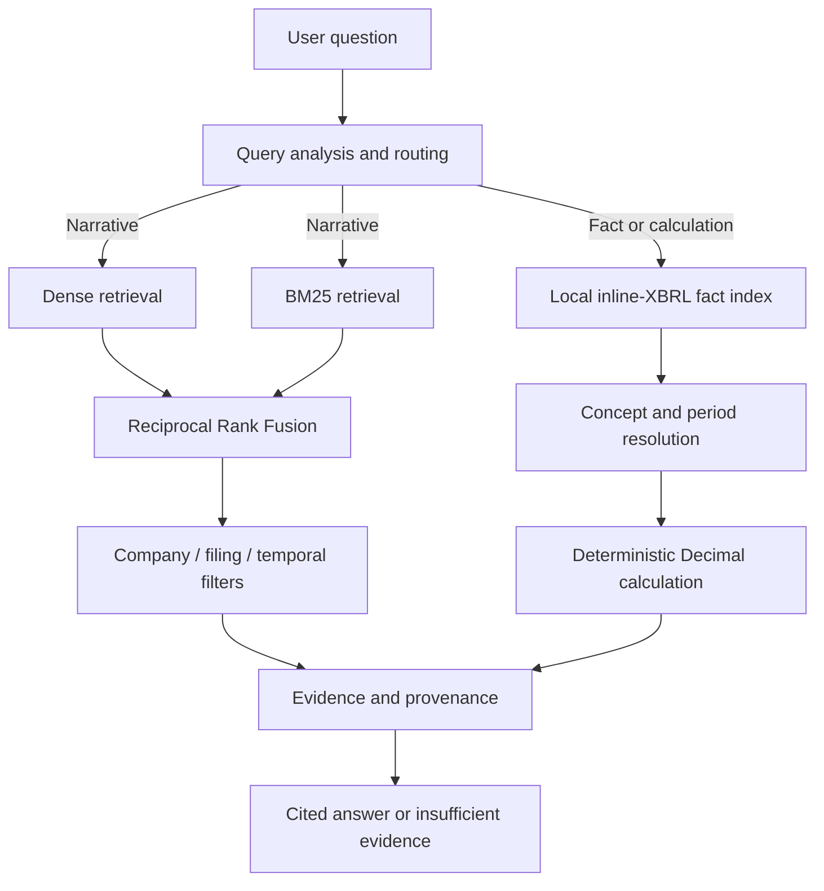

# Financial RAG — Evidence-Grounded SEC Retrieval & XBRL Analytics

An evaluation-first Python project for SEC filings. It combines semantic and lexical search,
company and period routing, deterministic XBRL calculations, and source-level provenance.
The public V2 scope is measured against a frozen benchmark; narrative queries return evidence,
not generated financial advice.

> **V2 scope:** this repository contains the validated V2 retrieval
> benchmark and deterministic SEC XBRL answer path. V3/V4 local language-model
> generation, semantic verification, the GPT-OSS judge, and the development
> pilot are outside this release. No Basic-versus-Verified improvement or
> judge reliability claim is made. See [release scope](docs/RELEASE_SCOPE.md).

The included [MIT license](LICENSE) covers the code. SEC filings and local model weights are
downloaded separately and are not bundled with this repository.

## Results

| Metric | Dense baseline | Final routed pipeline |
| --- | ---: | ---: |
| Recall@1 | 0.080 | **0.180** |
| Recall@5 | 0.280 | **0.460** |
| Recall@10 | 0.453 | **0.633** |
| MRR | 0.174 | **0.303** |
| nDCG@10 | 0.057 | **0.119** |

- **+64.3% relative Recall@5 improvement** on the same frozen 150-question benchmark
- **59 real SEC filings:** 13 10-K and 46 10-Q filings from six companies
- **9,166 text chunks** and **60,950 normalized XBRL facts**
- **27/27 labeled XBRL answer cases passed**
- **1.000 citation accuracy and 1.000 evidence accuracy** on those 27 labeled cases

The authoritative results are in
[`experiments/benchmark_v2/final_benchmark.json`](experiments/benchmark_v2/final_benchmark.json),
with methodology and denominators in [Benchmark V2](docs/BENCHMARK.md). These
are historical results on the frozen 150-question retrieval and 27-question
financial-answer suites, not a newly rerun benchmark or a claim about other
issuers or narrative answer generation.

## Problem

Naive financial RAG is vulnerable to predictable errors: adjacent filings use nearly identical
language, dense retrieval can confuse companies or reporting periods, exact financial terminology
may be better served by lexical matching, and numerical answers can be hallucinated or calculated
from incompatible periods. Without labeled evidence and repeatable evaluation, those failures are
easy to miss.

## Solution

- **Dense retrieval** finds semantically related filing passages.
- **BM25** preserves exact terminology that embeddings can blur.
- **Reciprocal Rank Fusion (RRF)** combines both rankings without comparing incompatible scores.
- **Company, form, and period routing** reduces cross-filing and temporal confusion.
- **A deterministic XBRL path** resolves concepts and periods, then performs `Decimal`
  calculations instead of asking an LLM to invent or compute financial values.
- **Evidence provenance** carries accession, filing, period, section or XBRL concept, and SEC source
  URL into each answer.
- **Evaluation-first development** keeps all retrieval variants on the same frozen judgments and
  retains losing configurations and failure categories for inspection.

## Architecture



The final narrative pipeline is metadata-routed Dense+BM25 RRF. The measured cross-encoder remains
an experiment, not part of Final, because its benchmark quality/latency trade-off was inferior.

## Evaluation

Benchmark V2 contains 150 labeled retrieval questions over 59 real filings from six companies and
multiple reporting periods (2024–2026). Each question has ground-truth company, form, reporting
period, accession, section, source URL, evidence excerpt, and relevant chunk IDs. All four retrieval
configurations receive the same ordered dataset and one top-10 ranking per query.

- **Recall@K:** share of questions with at least one labeled chunk in the first K results.
- **MRR:** rewards placing the first relevant chunk earlier in the ranking.
- **nDCG@10:** measures relevance placement across the top ten results.

The frozen dataset hashes and construction metadata are recorded in
[`experiments/benchmark_v2/manifest.json`](experiments/benchmark_v2/manifest.json).

### Benchmark results

| Pipeline | Recall@1 | Recall@5 | Recall@10 | MRR | nDCG@10 | p95 |
| --- | ---: | ---: | ---: | ---: | ---: | ---: |
| Dense | 0.080 | 0.280 | 0.453 | 0.174 | 0.057 | 107.62 ms |
| Dense + BM25 + RRF | 0.060 | 0.233 | 0.367 | 0.138 | 0.047 | 737.86 ms |
| Hybrid + cross-encoder | 0.107 | 0.260 | 0.367 | 0.177 | 0.053 | 3,727.45 ms |
| **Final: routed Dense + BM25 + RRF** | **0.180** | **0.460** | **0.633** | **0.303** | **0.119** | **807.85 ms** |

Generic hybrid retrieval did **not** beat Dense on this benchmark (Recall@5 0.233 vs. 0.280). The
measured gain appeared only in the domain-aware pipeline that combined hybrid retrieval with
company, filing, and temporal routing: Recall@5 reached 0.460, a **64.3% relative improvement** over
Dense. This comparison supports the routing decision; it does not by itself prove causal attribution.

The cross-encoder was also measured rather than assumed to help. It was excluded from Final because
Recall@5 remained below Dense while p95 rose to 3.73 s. Final's warmed p95 was **807.85 ms on the
benchmark's local CPU**, versus 107.62 ms for Dense—comparative measurements, not a production SLA.

### Failure analysis

Final missed all labeled chunks in the top ten for 55 of 150 questions:

| Failure category | Count | Share of Final failures |
| --- | ---: | ---: |
| `WRONG_PERIOD` | 28 | 50.9% |
| `WRONG_SECTION` | 27 | 49.1% |

Routing eliminated observed wrong-company failures in Final, but temporal and section-level
ambiguity remain its main retrieval constraints.

Full methodology, confidence intervals, stage latencies, and per-pipeline failure tables are in
[`docs/BENCHMARK.md`](docs/BENCHMARK.md).

## Financial Reasoning & Provenance

Numerical questions do not rely on free-form generation:

```text
Question -> XBRL facts -> concept and period resolution
         -> deterministic calculation -> evidence/provenance -> answer
```

The engine selects filing-backed facts, uses exact `Decimal` arithmetic where calculation is
required, and returns `insufficient_evidence` when a required operand or period is unavailable.
Every result is tied to SEC provenance. Narrative citations identify the chunk, company, filing,
period, section, accession, and URL; structured citations identify the XBRL concept and source fact.
All **27/27 labeled answer cases passed**, with **1.000 citation accuracy and 1.000 evidence
accuracy** on that bounded suite—not a claim of universal financial QA accuracy.

### End-to-end benchmark example

> **Question:** What was Apple Inc. revenue in 2025 annual filing?

- **Routing:** `structured_fact`
- **Resolved evidence:** Apple Inc. / 10-K / fiscal 2025 /
  `us-gaap:RevenueFromContractWithCustomerExcludingAssessedTax`
- **Answer:** USD 416,161,000,000
- **Provenance:** accession `0000320193-25-000079`,
  [SEC filing](https://www.sec.gov/Archives/edgar/data/320193/000032019325000079/aapl-20250927.htm)

This example is the first labeled case in
[`data/eval/benchmark_v2_answers.jsonl`](data/eval/benchmark_v2_answers.jsonl), not a hand-written
demo.

## Quick Start

Python 3.11+ is required. SEC ingestion also requires a descriptive User-Agent with contact
information. The commands below use PowerShell; see the note after them for macOS/Linux.

```powershell
git clone https://github.com/efremov7roman-dot/financial-rag-evaluation.git
cd financial-rag-evaluation

python -m venv .venv
.\.venv\Scripts\Activate.ps1
python -m pip install --upgrade pip
python -m pip install -e ".[dev]"

# The source-only checks need no SEC downloads, index, or local model.
financial-rag info
python -m pytest -q
python -m ruff check .
python -m ruff format --check .
python -m mypy --strict src tests

Copy-Item .env.example .env
# Set FINANCIAL_RAG_SEC_USER_AGENT in .env, for example:
# FinancialRAG/0.1 research@example.com

# Ingest a bounded sample and build local indexes.
financial-rag ingest 320193 --form 10-K --limit 1
financial-rag build-index
financial-rag build-fact-index

# Query narrative and structured paths.
financial-rag query-hybrid "What risks could materially affect Apple's business?" --top-k 5
financial-rag ask-financial "What was Apple Inc. revenue in 2025 annual filing?"

```

On macOS/Linux, activate with `source .venv/bin/activate`. No external database is required; the
first index build downloads the configured local ONNX embedding model.
The query commands are optional demos after ingestion and index building;
they require public SEC downloads and model weights. Tests do not.

## Reproducing the Benchmark

Large SEC files, indexes, and model weights are intentionally excluded from Git. From a fresh clone,
the checked-in corpus manifest downloads the exact 59 public filings, validates source hashes,
recreates the processed corpus, builds dense and XBRL indexes, and verifies frozen dataset hashes:

```powershell
financial-rag reproduce-benchmark-v2

financial-rag run-final-benchmark `
  --retrieval-dataset data/eval/benchmark_v2_retrieval.jsonl `
  --answer-dataset data/eval/benchmark_v2_answers.jsonl `
  --experiments-dir experiments/benchmark_v2 `
  --skip-indexing

financial-rag verify-final-benchmark `
  --artifact experiments/benchmark_v2/final_benchmark.json `
  --retrieval-dataset data/eval/benchmark_v2_retrieval.jsonl `
  --answer-dataset data/eval/benchmark_v2_answers.jsonl
```

- Dataset: `data/eval/benchmark_v2_retrieval.jsonl` and
  `data/eval/benchmark_v2_answers.jsonl`
- Frozen question hashes: `experiments/benchmark_v2/manifest.json`
- Exact filing and processing contract: `experiments/benchmark_v2/corpus_manifest.json`
- Canonical result: `experiments/benchmark_v2/final_benchmark.json`
- Human-readable report: `docs/BENCHMARK.md`

Set `FINANCIAL_RAG_SEC_USER_AGENT` in `.env` before reproduction. The workflow fails instead of
substituting another filing if an accession, source hash, processed hash, dataset hash, corpus
fingerprint, or fact index differs. Use `--measure-indexing` in the benchmark command to measure a
fresh index build. Local latency will vary; checked-in canonical results are never rewritten merely
to improve presentation.

## Tech Stack

- Python 3.11+, Typer, Pydantic, FastAPI, pytest, Ruff, and mypy
- SEC EDGAR 10-K/10-Q HTML and inline XBRL
- `BAAI/bge-small-en-v1.5` via FastEmbed/ONNX Runtime
- Exact NumPy cosine index, in-memory Okapi BM25, and Reciprocal Rank Fusion
- Optional `Xenova/ms-marco-MiniLM-L-6-v2` cross-encoder for measured comparison
- JSONL ground truth and JSON benchmark artifacts with fingerprint verification

## Limitations

- The benchmark has 150 retrieval questions over 59 filings from six large US technology
  companies; it should not be generalized to all issuers, industries, languages, or SEC forms.
- The structured answer evaluation contains 27 labeled cases and covers only documented concepts
  and deterministic calculation rules.
- Section-level relevance labels do not measure passage completeness for long-form answers.
- Metadata filtering operates on a bounded candidate pool, so the correct period can be absent
  before filtering.
- Latency was measured on one local CPU after warm-up and is not a production SLA.
- Narrative results return ranked evidence rather than LLM-generated prose.
- The local API does not provide authentication, tenant isolation, or distributed serving.

See [`docs/architecture.md`](docs/architecture.md) for implementation boundaries and
[`docs/operations.md`](docs/operations.md) for the optional single-worker API/Docker workflow.
